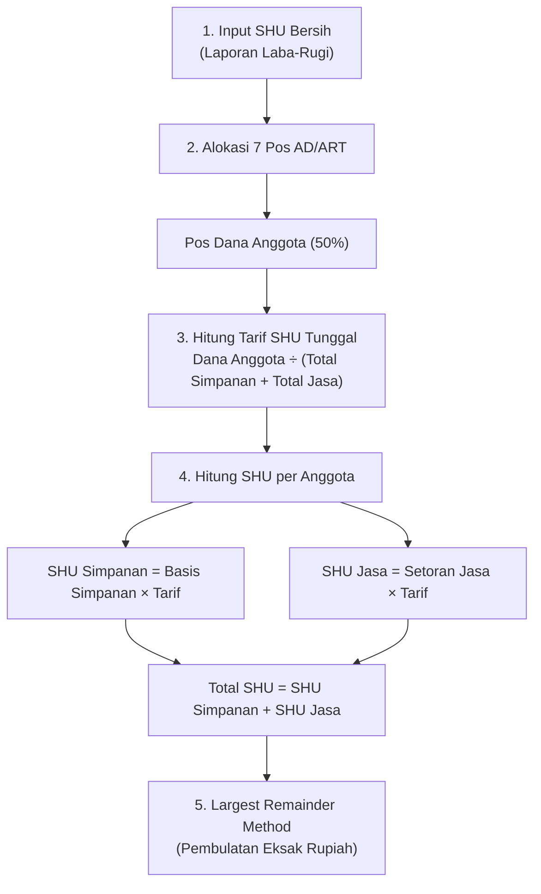

# Panduan Lengkap Perhitungan SHU & Tanya-Jawab Sidang Skripsi
**Sistem Informasi Simpanan Anggota dan Perhitungan SHU — Kopdes Kedungsana**

Dokumen ini disusun sebagai bahan literasi mandiri dan persiapan sidang/presentasi Tugas Akhir (TA). Dokumen ini membedah seluruh rumus matematis, elemen-elemen keuangan, serta strategi argumentasi ilmiah dalam mempertahankan validitas sistem pembagian SHU.

---

## 1. Rangkaian Rumus Matematis SHU

Perhitungan SHU di sistem ini berjalan secara deterministik melalui 5 tahapan:

### Tahap 1: Alokasi Dana Anggota
$$\text{Dana Anggota} = \text{SHU Bersih} \times \text{Persentase Dana Anggota}$$
*(Default AD/ART: Persentase Dana Anggota = 50%)*

### Tahap 2: Basis Finansial per Anggota
* **Basis Simpanan Anggota ($S_i$):**
  $$S_i = \text{Pokok} + \text{Wajib} + \text{Sukarela} + \text{Investasi}$$
* **Basis Partisipasi Jasa Anggota ($J_i$):**
  $$J_i = \text{Total Akumulasi Transaksi Jasa / Belanja Anggota}$$
* **Total Basis Seluruh Anggota Koperasi:**
  $$\text{Total Basis} = \sum_{i=1}^n S_i + \sum_{i=1}^n J_i = \text{Total Simpanan} + \text{Total Setoran Jasa}$$

### Tahap 3: Tarif SHU Tunggal
Sistem menggunakan satu tarif proporsional yang sama untuk simpanan dan jasa transaksi:
$$\text{Tarif SHU} = \frac{\text{Dana Anggota}}{\text{Total Basis}} = \frac{\text{Dana Anggota}}{\text{Total Simpanan} + \text{Total Setoran Jasa}}$$

### Tahap 4: Pembagian SHU per Anggota
Untuk setiap anggota ke-$i$:
* **SHU Simpanan:**
  $$\text{SHU Simpanan}_i = S_i \times \text{Tarif SHU}$$
* **SHU Jasa:**
  $$\text{SHU Jasa}_i = J_i \times \text{Tarif SHU}$$
* **Total SHU Diterima Anggota:**
  $$\text{Total SHU}_i = \text{SHU Simpanan}_i + \text{SHU Jasa}_i$$

### Tahap 5: Algoritma Pembulatan Sisa Terbesar (*Largest Remainder Method*)
Perkalian desimal $\text{Basis} \times \text{Tarif}$ menghasilkan pecahan sen. Jika dibulatkan bebas per orang, total kas yang keluar bisa selisih beberapa rupiah dari plafon Dana Anggota. Sistem mengatasinya dengan langkah:
1. Seluruh nilai eksak dibulatkan **ke bawah** (`Math.floor`):
   $$\text{SHU Dibulatkan}_i = \lfloor \text{Hasil Eksak}_i \rfloor$$
2. Menghitung sisa kas akibat pembulatan:
   $$\text{Sisa Kas} = \text{Dana Anggota} - \sum \text{SHU Dibulatkan}_i$$
3. Mengurutkan anggota berdasarkan **nilai desimal pecahan terbesar** ($\text{Hasil Eksak}_i - \text{SHU Dibulatkan}_i$).
4. Membagikan sisa kas **Rp 1 per anggota** mulai dari urutan pecahan terbesar sampai sisa kas menjadi 0.
5. **Hasil:** Jumlah total SHU yang dibagikan **selalu cocok 100% rupiah-demi-rupiah** dengan kas Dana Anggota.

---

## 2. Penjabaran Rinci Elemen-Elemen Pembentuk

### A. Elemen Finansial Global (Tingkat Koperasi)
| Elemen | Definisi & Sifat | Keterangan / Sumber |
|---|---|---|
| **SHU Bersih Tahun Buku** | Keuntungan bersih operasional tahunan koperasi (Pendapatan dikurangi Biaya operasional, ATK, Rapat RAT, Pajak). | Diinput manual oleh bendahara di halaman *SHU Cepat* dari berkas Laporan Laba/Rugi. |
| **Dana Cadangan (25%)** | Dana penyisihan untuk memperkuat modal sendiri dan menutup risiko kerugian masa depan. | Kas Organisasi (tidak dibagikan ke anggota). |
| **Dana Anggota (50%)** | Bagian keuntungan yang dikembalikan kepada anggota sebanding modal dan jasa usaha. | **Satu-satunya pos yang dibagikan ke anggota**. |
| **Dana Pengurus (10%)** | Insentif tahunan jajaran pengurus & pengawas atas pengelolaan organisasi. | Kas Organisasi. |
| **Dana Karyawan (5%)** | Insentif tahunan pengelola / staf operasional koperasi. | Kas Organisasi. |
| **Dana Pendidikan (2,5%)** | Anggaran pelatihan perkoperasian bagi anggota dan pengurus. | Kas Organisasi. |
| **Dana PMDK (2,5%)** | Dana Pembangunan Daerah Kerja / pembangunan desa lingkungan kerja koperasi. | Kas Organisasi. |
| **Dana Sosial (5%)** | Dana bantuan sosial kemasyarakatan / santunan warga. | Kas Organisasi. |
| **Tarif SHU** | Rasio desimal pengali hak anggota per Rp 1 modal/jasa yang dimiliki. | Dihitung otomatis: $\frac{\text{Dana Anggota}}{\text{Total Basis}}$. |

### B. Elemen Finansial Anggota (Tingkat Individu)
| Elemen | Definisi & Karakteristik | Ketentuan di Sistem |
|---|---|---|
| **Simpanan Pokok** | Uang pendaftaran pertama kali saat resmi menjadi anggota. | Rp 100.000 (tidak bisa diambil selama aktif). |
| **Simpanan Wajib** | Iuran rutin bulanan anggota. | Rp 10.000 / bulan. |
| **Simpanan Sukarela** | Tabungan sukarela fleksibel anggota dengan jumlah bebas. | Diikutsertakan dalam basis perhitungan mengikuti acuan Laporan RAT 2024. |
| **Investasi Anggota** | Penyertaan modal tambahan anggota untuk tahun buku berjalan. | Fitur pelengkap jika koperasi membutuhkan suntikan modal tahunan. |
| **Partisipasi / Setoran Jasa** | Akumulasi kontribusi transaksi anggota terhadap unit usaha (belanja toko/jasa pinjaman). | Menjadi dasar pembagian SHU Jasa. |

### C. Elemen Output
| Elemen | Definisi |
|---|---|
| **SHU Simpanan** | Bagian keuntungan atas jasa penyertaan modal simpanan anggota. |
| **SHU Jasa** | Bagian keuntungan atas jasa partisipasi/keaktifan bertransaksi anggota. |
| **Total SHU** | Jumlah uang tunai akhir yang berhak diterima anggota pada saat RAT. |

---

## 3. Contoh Simulasi Konkret

### Kasus A: Kondisi Awal Kedungsana (Setoran Jasa = 0)
* **SHU Bersih Tahun Buku:** Rp 10.000.000
* **Dana Anggota (50%):** Rp 5.000.000
* **Total Simpanan Seluruh Anggota:** Rp 100.000.000
* **Total Setoran Jasa Seluruh Anggota:** Rp 0

$$\text{Tarif SHU} = \frac{\text{Rp } 5.000.000}{\text{Rp } 100.000.000 + 0} = 0,05 \quad (5\%)$$

* **Anggota A** (Total Simpanan Rp 2.000.000, Jasa Rp 0):
  * SHU Simpanan = Rp 2.000.000 $\times$ 5% = **Rp 100.000**
  * SHU Jasa = Rp 0 $\times$ 5% = **Rp 0**
  * Total Diterima = **Rp 100.000**
  *(100% Dana Anggota terbagi habis ke simpanan, tidak ada sisa kas mengendap).*

---

### Kasus B: Kondisi Setelah Unit Usaha Berjalan (Ada Setoran Jasa)
* **Dana Anggota (50%):** Rp 5.000.000
* **Total Simpanan Seluruh Anggota:** Rp 80.000.000
* **Total Setoran Jasa Seluruh Anggota:** Rp 20.000.000
* **Total Basis Gabungan:** Rp 80.000.000 + Rp 20.000.000 = **Rp 100.000.000**

$$\text{Tarif SHU} = \frac{\text{Rp } 5.000.000}{\text{Rp } 100.000.000} = 0,05 \quad (5\%)$$

* **Anggota B** (Simpanan Rp 1.500.000, Setoran Jasa Belanja Rp 500.000):
  * SHU Simpanan = Rp 1.500.000 $\times$ 5% = **Rp 75.000**
  * SHU Jasa = Rp 500.000 $\times$ 5% = **Rp 25.000**
  * Total Diterima = Rp 75.000 + Rp 25.000 = **Rp 100.000**
  *(Anggota yang aktif bertransaksi mendapat bagian dari porsi jasa).*

---

## 4. Cheat-Sheet Tanya-Jawab Sidang Skripsi

### ❓ Pertanyaan 1: *"Nilai SHU Bersih diinput manual oleh admin di form. Kenapa tidak dihitung otomatis oleh sistem?"*
> **🎯 Jawaban Anda:**
> *"Batasan masalah dalam penelitian TA ini difokuskan pada **Pengelolaan Simpanan Anggota dan Distribusi/Alokasi SHU**, bukan pada Sistem Akuntansi Umum (General Ledger/ERP).*
> 
> *Nilai SHU Bersih merupakan hasil akhir dari Laporan Perhitungan Hasil Usaha (Laba/Rugi) yang disusun bendahara dari seluruh pendapatan koperasi dikurangi beban operasional, rapat RAT, ATK, dan pajak. Nilai resmi yang telah diaudit dan disahkan pra-RAT tersebut diinput satu kali ke sistem agar sistem dapat memecahnya secara otomatis dan transparan ke 7 pos AD/ART serta membagikannya ke ratusan anggota dengan metode pembulatan sisa terbesar."*

---

### ❓ Pertanyaan 2: *"Kenapa memakai 1 tarif tunggal (Dana Anggota 50%), bukan memisah kaku persentase Jasa Modal vs Jasa Usaha di AD/ART?"*
> **🎯 Jawaban Anda:**
> *"Pendekatan Tarif Tunggal ini didasarkan pada dua alasan kuat:*
> 1. ***Mengikuti Bukti Empiris Koperasi Acuan (RAT 2024)**: Anggaran Dasar koperasi acuan menetapkan satu pos untuk anggota yaitu **Dana Anggota sebesar 50%**, dan membaginya dengan rumus tarif $\frac{\text{Dana Anggota}}{\text{Total Simpanan} + \text{Total Jasa}}$. Rumus ini telah kami validasi dan terbukti cocok 100% dengan total pembagian pada laporan resmi RAT.*
> 2. ***Mencegah Dana Tertahan (Dana Menganggur)**: Jika dipisah persentase kaku (misal Jasa Modal 35% dan Jasa Transaksi 15%), pada kondisi koperasi yang baru menjalankan unit simpanan (transaksi jasa = 0), dana 15% tersebut akan macet dan tidak bisa dibagikan kepada anggota. Dengan tarif tunggal, alokasi dana beradaptasi dinamis: jika jasa bernilai 0, 100% Dana Anggota dinikmati penyimpan modal secara adil."*

---

### ❓ Pertanyaan 3: *"Apakah adil jika SHU Jasa bernilai Rp 0 dan seluruh Dana Anggota dialokasikan ke simpanan?"*
> **🎯 Jawaban Anda:**
> *"Sangat adil untuk kondisi saat ini, karena:*
> * Sesuai prinsip UU No. 25/1992 Pasal 5 ayat (1) huruf c, SHU dibagikan sebanding dengan jasa/partisipasi anggota.
> * Pada Kopdes Kedungsana yang saat ini baru menjalankan **unit simpanan**, satu-satunya bentuk partisipasi nyata anggota dalam menanggung risiko permodalan koperasi adalah lewat **simpanan (pokok, wajib, dan sukarela)**.
> * Untuk menjamin sistem ini **siap untuk masa depan (*scalable*)**, arsitektur sistem tetap menyediakan modul pencatatan **Partisipasi Jasa Usaha** yang dapat diisi kapan saja ketika unit usaha toko desa atau simpan pinjam mulai bergulir."*

---

### ❓ Pertanyaan 4: *"Bagaimana jika nanti koperasi mulai membuka unit toko atau simpan pinjam?"*
> **🎯 Jawaban Anda:**
> *"Sistem sudah siap tanpa perlu merombak kode program. Pengurus cukup membuka menu **Input Data $\to$ Detail Anggota $\to$ Partisipasi Jasa Usaha Anggota**, lalu mencatat nominal transaksi jasa anggota untuk tahun buku terkait. Sistem akan otomatis menghitung SHU Jasa secara proporsional sesuai tarif yang sama."*

---

## 5. Sumber Kebenaran Kode (Source of Truth)

Seluruh logika perhitungan di atas dikonsolidasikan pada berkas-berkas berikut:
* **Perhitungan SHU Core:** [`src/features/admin/utils/shu-calculator.ts`](../src/features/admin/utils/shu-calculator.ts) (`calculateShuPools`, `calculateShuRate`, `distributeMemberShu`).
* **Pengambilan Data & Filter Anggota:** [`src/features/admin/utils/shu-basis-loader.ts`](../src/features/admin/utils/shu-basis-loader.ts) (`loadMemberShuBasisRows`).
* **UI Halaman SHU Cepat:** [`app/admin/quick-shu/page.tsx`](../app/admin/quick-shu/page.tsx).
* **UI Input Jasa Anggota (Gold Plating):** [`src/features/member/presentation/member-detail-page.tsx`](../src/features/member/presentation/member-detail-page.tsx).
* **Validasi Skrip Blackbox E2E:** [`blackbox/07-shu.spec.ts`](../blackbox/07-shu.spec.ts).

