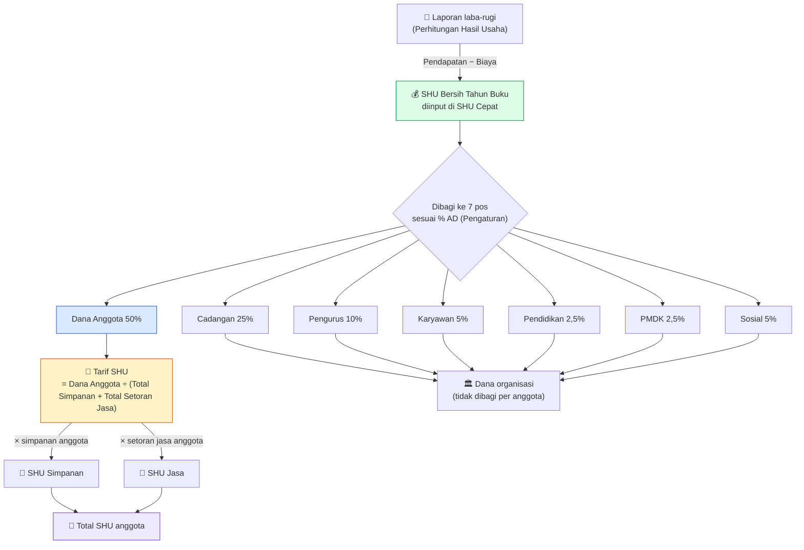
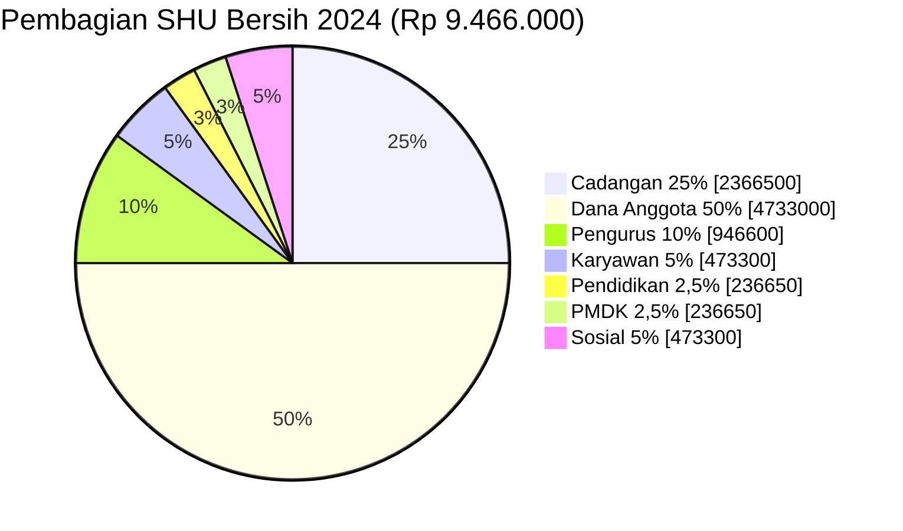
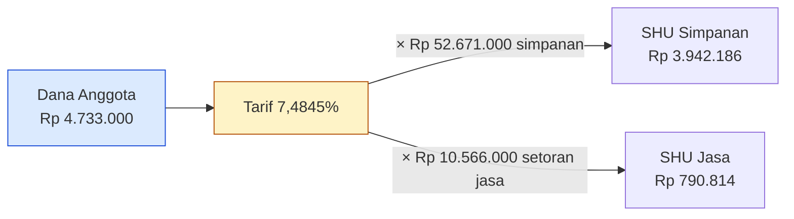
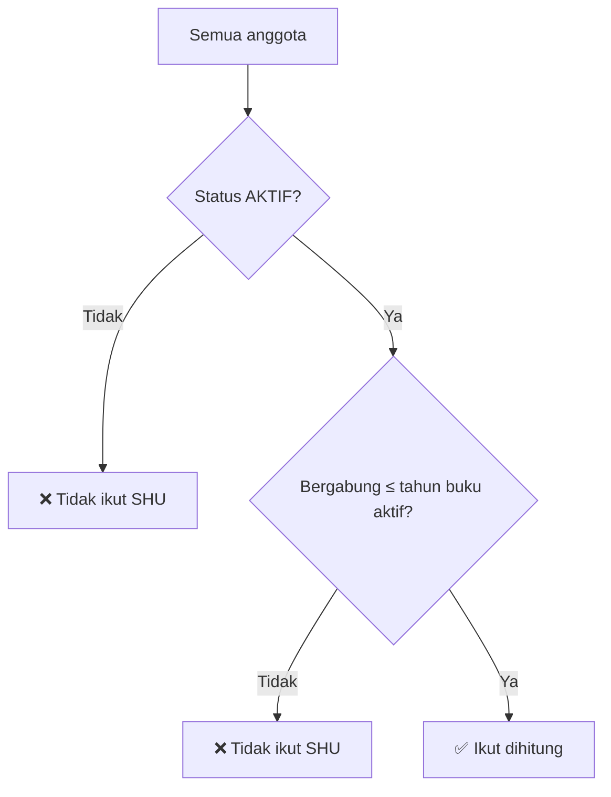

# Rumus Perhitungan SHU — Kopdes Kedungsana

**Snapshot per:** 31 Oktober 2026.
**Acuan:** *Laporan RAT 2024* dan *Laporan Tahunan 2024* Koperasi Mitra Surya Kemuning (`OLD DOC/LAPORAN RAT 2024.xlsx`, `OLD DOC/LAPORAN TAHUNAN 2024.docx`). Klien menetapkan laporan ini sebagai patokan perhitungan SHU sistem.
Kode adalah sumber kebenaran: [shu-calculator.ts](../src/features/admin/utils/shu-calculator.ts), [shu-basis-loader.ts](../src/features/admin/utils/shu-basis-loader.ts), [quick-shu/page.tsx](../app/admin/quick-shu/page.tsx).

> **Catatan tampilan:** diagram memakai Mermaid. Di GitHub langsung tampil. Di VS Code, pasang ekstensi *Markdown Preview Mermaid Support*, lalu buka Preview (`Ctrl+Shift+V`).

> **Angka contoh di dokumen ini adalah data asli RAT 2024** dari laporan acuan di atas, bukan ilustrasi.

---

## 1. Gambaran besar



Hanya **pos Dana Anggota** yang sampai ke anggota. Pos ini dibagi dengan **satu tarif yang sama** untuk simpanan dan setoran jasa.

---

## 2. Langkah demi langkah (data RAT 2024)

### Langkah 1 — SHU Bersih (input manual)

Dari sheet *Perhitungan Hasil Usaha*:

| Uraian | 2024 |
|---|---|
| Pendapatan jasa simpan pinjam | Rp 10.566.000 |
| Biaya ATK | Rp 300.000 |
| Biaya RAT | Rp 800.000 |
| **SHU Bersih** | **Rp 9.466.000** |

- Sistem **tidak menghitung** angka ini karena belum mencatat pendapatan dan biaya. Bendahara mengetiknya di **SHU Cepat → Transparansi Alokasi SHU AD/ART → SHU Bersih Tahun Buku**.
- Disimpan per tahun buku (tabel `fiscal_year_shu`). Tidak boleh negatif; kalau koperasi rugi, isi 0.

### Langkah 2 — Alokasi ke 7 pos

```
Pos = SHU Bersih × persentase pos (dibulatkan ke Rupiah)
```

| No | Pos | % | Hasil | Ke mana? |
|---|---|---|---|---|
| 1 | Cadangan | 25% | Rp 2.366.500 | Organisasi |
| 2 | **Dana Anggota** | **50%** | **Rp 4.733.000** | **Anggota** |
| 3 | Dana Pengurus | 10% | Rp 946.600 | Organisasi |
| 4 | Dana Karyawan | 5% | Rp 473.300 | Organisasi |
| 5 | Dana Pendidikan | 2,5% | Rp 236.650 | Organisasi |
| 6 | Dana Pembangunan Daerah Kerja (PMDK) | 2,5% | Rp 236.650 | Organisasi |
| 7 | Dana Sosial | 5% | Rp 473.300 | Organisasi |
| | **Total** | **100%** | **Rp 9.466.000** | |



> Total 7 persentase **wajib tepat 100%**. Halaman Pengaturan menolak menyimpan kalau tidak.

### Langkah 3 — Hitung Tarif SHU

```
Basis simpanan anggota = Pokok + Wajib + Sukarela + Investasi
Tarif SHU = Dana Anggota ÷ (Total basis simpanan + Total setoran jasa)
```

| | RAT 2024 |
|---|---|
| Dana Anggota | Rp 4.733.000 |
| Total simpanan (Pokok 6.000.000 + Wajib 26.750.000 + Sukarela 19.921.000) | Rp 52.671.000 |
| Total setoran jasa | Rp 10.566.000 |
| **Tarif** = 4.733.000 ÷ (52.671.000 + 10.566.000) | **7,4845%** |

Artinya, setiap Rp 1 simpanan atau setoran jasa mendapat **≈ Rp 0,075** SHU.

### Langkah 4 — SHU per anggota

```
SHU Simpanan = Basis simpanan anggota × Tarif
SHU Jasa     = Setoran jasa anggota   × Tarif
Total SHU    = SHU Simpanan + SHU Jasa
```

**Contoh 3 anggota dari RAT 2024:**

| Anggota | Simpanan | Setoran Jasa | SHU Simpanan | SHU Jasa | **Total** |
|---|---|---|---|---|---|
| Neni Mulyani | 1.620.000 | 340.000 | 1.620.000 × 7,4845% = **121.250** | 340.000 × 7,4845% = **25.447** | **146.697** |
| Ikit Mastika | 1.040.000 | 710.000 | **77.839** | **53.140** | **130.979** |
| Oman Nurohman | 829.000 | 0 | **62.047** | **0** | **62.047** |

**Pembulatan (metode sisa terbesar).** Hasil `basis × tarif` jarang bulat, jadi tiap nilai SHU dibulatkan ke rupiah utuh. Kalau tiap nilai dibulatkan sendiri-sendiri, totalnya bisa meleset beberapa rupiah dari Dana Anggota. Sistem karena itu:

1. membulatkan **ke bawah** semua nilai SHU Simpanan dan SHU Jasa,
2. menghitung sisa rupiah = Dana Anggota − jumlah hasil pembulatan,
3. memberikan sisa itu **Rp 1 per nilai** kepada nilai dengan pecahan terbesar.

Hasilnya, total SHU terbagi **selalu tepat sama** dengan Dana Anggota, dan tiap nilai paling jauh berbeda Rp 1 dari hasil hitung eksak. Contoh: Dana Anggota Rp 1.000.000 dibagi rata ke 3 anggota → 333.333,33 masing-masing → dibulatkan ke bawah 333.333 × 3 = 999.999 → sisa Rp 1 diberikan ke satu anggota → 333.334 + 333.333 + 333.333 = **1.000.000**. Pada data RAT 2024 metode ini menghasilkan angka yang sama persis dengan pembulatan biasa, karena di sana totalnya kebetulan sudah pas.



### Bagaimana kalau Setoran Jasa = 0 (kondisi Kedungsana sekarang)?

```
Tarif = Dana Anggota ÷ (Total simpanan + 0)
```

Seluruh Dana Anggota dibagi lewat simpanan dan **tidak ada dana yang tersisa**. Ini perbedaan penting dari rumus sebelumnya, di mana jatah Jasa Transaksi menganggur sebagai "belum terdistribusi".

---

## 3. Apa itu Setoran Jasa?

Pada RAT 2024, **total Setoran Jasa = Rp 10.566.000 = Pendapatan jasa simpan pinjam**. Artinya, setoran jasa anggota adalah **jasa pinjaman yang dibayar anggota tersebut** (laporan tahunan: provisi 1% dan jasa 2% per bulan). Anggota yang meminjam dan membayar jasa mendapat SHU Jasa lebih besar.

Untuk Kopdes Kedungsana, data ini belum dicatat sistem (Setoran Jasa masih dorman). Nantinya sumbernya bisa berupa jasa pinjaman atau belanja di unit usaha, tergantung usaha koperasi.

---

## 4. Siapa yang ikut dihitung?



| Data | Aturan |
|---|---|
| Status anggota | Hanya **aktif** |
| Tanggal bergabung | Tahun bergabung ≤ tahun buku aktif |
| Pokok, Wajib, Sukarela | Saldo akumulasi **sampai dengan** tahun buku aktif (seperti "per 31 Desember" di RAT) |
| Investasi | Hanya investasi **tahun buku aktif** (fitur tambahan Kedungsana, tidak ada di RAT acuan) |
| Setoran Jasa | Akumulasi sampai dengan tahun buku aktif |

---

## 5. Validasi terhadap RAT 2024

Fungsi perhitungan sistem (`calculateShuPools`, `totalShuBasis`, `calculateShuRate`, `distributeMemberShu`) dijalankan dengan data 74 anggota RAT 2024 (simpanan dan setoran jasa dari laporan, SHU bersih Rp 9.466.000, Dana Anggota 50%), lalu dibandingkan dengan kolom SHU Simpanan dan SHU Jasa pada laporan.

| Hasil | Jumlah nilai (dari 148) |
|---|---|
| Sama persis | 129 |
| Selisih Rp 1 (pembulatan) | 11 |
| Selisih > Rp 1 | 8 |
| **Total SHU dibagikan** | Sistem Rp 4.733.000 = Laporan Rp 4.733.000 ✅ |

Delapan selisih > Rp 1 terjadi pada nilai yang **diketik manual** di laporan (bukan rumus Excel). Polanya cocok dengan kesalahan input, misalnya:

| Anggota | Kolom | Sistem | Laporan | Dugaan penyebab |
|---|---|---|---|---|
| Tina Agustina | SHU Jasa | 14.969 | 14.696 | Digit tertukar (969 ↔ 696) |
| Cucun Cunayah | SHU Jasa | 5.838 | 5.938 | Salah satu digit |
| Hj. Djedjeh Zakiah | SHU Simpanan | 168.627 | 168.402 | Laporan cocok dengan simpanan 2.250.000; di daftar simpanan tercatat 2.253.000 |
| Yani Wahyuni | SHU Simpanan | 151.562 | 151.942 | Laporan cocok dengan simpanan ±2.030.000; di daftar simpanan tercatat 2.025.000 |

Kolom "dugaan penyebab" adalah analisis dari angka, **belum dikonfirmasi bendahara**. Selisih antar-anggota itu saling menutup sehingga total laporan tetap Rp 4.733.000.

---

## 6. Rumus lama vs rumus baru

| | **Lama** | **Baru (mengikuti RAT 2024)** |
|---|---|---|
| Sumber SHU | `10% × total modal` (proksi) | SHU bersih dari laporan laba-rugi |
| Pos untuk anggota | Jasa Modal 33,32% + Jasa Transaksi 6,68% (dua persentase tetap) | **Dana Anggota** (satu pos, default 50%) |
| Pos PMDK | Tidak ada | Ada (default 2,5%) |
| Basis simpanan | Pokok + Wajib + Investasi | **Pokok + Wajib + Sukarela** + Investasi |
| Cara bagi | Tiap pos dibagi terpisah sebanding basisnya | **Satu tarif** untuk simpanan dan jasa |
| Setoran Jasa = 0 | Jatah Jasa Transaksi menganggur | Seluruh Dana Anggota terbagi lewat simpanan |
| Persentase default | 40 / 33,32 / 6,68 / 5 / 5 / 5 / 5 | 25 / 50 / 10 / 5 / 2,5 / 2,5 / 5 |

> Catatan: 33,32 : 6,68 sama dengan rasio simpanan : setoran jasa pada RAT 2024 (52.671.000 : 10.566.000), dengan Dana Anggota 40%. Rasio itu hanya berlaku untuk data 2024. Rumus satu tarif menghitungnya ulang setiap tahun dari data yang sebenarnya.

---

## 7. Peta kode

| Bagian rumus | File |
|---|---|
| Input & simpan SHU bersih | [app/admin/quick-shu/page.tsx](../app/admin/quick-shu/page.tsx) (`handleSaveNetShu`) |
| Validasi SHU bersih | [save-fiscal-year-shu-use-case.ts](../src/features/shu/application/save-fiscal-year-shu-use-case.ts) |
| Tabel SHU per tahun buku | [setup_fiscal_year_shu.sql](../setup_fiscal_year_shu.sql) |
| Kolom pos Dana Anggota & PMDK | [setup_shu_dana_anggota.sql](../setup_shu_dana_anggota.sql) |
| 7 persentase pos (default) | [settings-actions.ts](../src/actions/settings-actions.ts), input di [pengaturan/page.tsx](../app/admin/pengaturan/page.tsx) |
| Langkah 2: Dana Anggota | `calculateShuPools` di [shu-calculator.ts](../src/features/admin/utils/shu-calculator.ts) |
| Langkah 3: Tarif SHU | `totalShuBasis`, `calculateShuRate` di [shu-calculator.ts](../src/features/admin/utils/shu-calculator.ts) |
| Langkah 4: SHU per anggota & pembulatan sisa terbesar | `distributeMemberShu` di [shu-calculator.ts](../src/features/admin/utils/shu-calculator.ts) |
| Siapa yang ikut dihitung | `loadMemberShuBasisRows` di [shu-basis-loader.ts](../src/features/admin/utils/shu-basis-loader.ts) |
| Dipakai juga oleh | Spreadsheet Live ([spreadsheet-modal.tsx](../src/features/admin/presentation/spreadsheet-modal.tsx)), Bundel RAT & backup ([rat-bundle-exporter.ts](../src/features/admin/utils/rat-bundle-exporter.ts)) |
